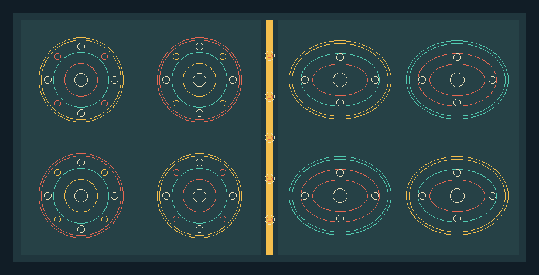

# Midpoint circle and ellipse drawing

Implemented by Muthii Eric Macharia, 166390, while the member originally
assigned this module was unavailable. Original assignment: Sayialel Eric
Lenina, 161492.

The module draws round and oval decorations for a geometric fabric swatch and
small circular button details for the later dress preview. Its interface is in
`include/kitenge/circles.hpp`:

```cpp
void drawCircleMidpoint(Canvas& canvas, Point center, int radius, Color color);
void drawEllipseMidpoint(Canvas& canvas, Point center,
                         int radiusX, int radiusY, Color color);
```

The center and radii are integer pixel coordinates. Only the outlines are
drawn. The canvas origin is at the upper left; increasing y moves downward.

## Circle midpoint steps

Starting from `(x, y) = (0, radius)`, the code plots the eight reflections
`(±x, ±y)` and `(±y, ±x)` around the center. The decision value starts at
`1 - radius`. At each x step it chooses the nearer candidate pixel: move x
alone while the midpoint is inside the circle, or move x and decrease y when
it is outside. Work stops when x passes y, because the remaining octants are
already represented by symmetry. A radius of zero plots the center pixel.

## Ellipse midpoint steps

An ellipse has four-way symmetry, so each computed `(x, y)` plots `(±x, ±y)`.
For positive radii, the first region advances x while the tangent is shallow,
using the midpoint between the east and southeast candidates. The second
region advances y toward zero while the tangent is steep, choosing between
the south and southeast candidates. The code maintains the scaled x and y
derivatives and updates a decision value at each step. `long double` keeps
the squared-radius calculations from overflowing ordinary 32-bit integers.

A zero x radius becomes a vertical segment. A zero y radius becomes a
horizontal segment. If both are zero, only the center pixel is drawn. Negative
radii throw `std::invalid_argument` for both functions. Pixels outside the
canvas are ignored safely, so an outline can touch or extend beyond an edge.

## Verification and limits

`tests/circle_tests.cpp` checks several radii and aspect ratios, cardinal
points, eight-way circle symmetry, four-way ellipse symmetry, outline-only
interiors, canvas edges, zero-size cases and rejection of negative radii.
The midpoint algorithms produce aliased one-pixel outlines. They do not fill
shapes or clip them to the dress panels, so decorative motifs should be placed
inside panel interiors during integration.

Run `circles_demo outputs/circles-ellipses.ppm` after building. The left half
shows circular medallions; the right half shows oval medallions. The central
strip suggests decorative buttons on a dress seam.


