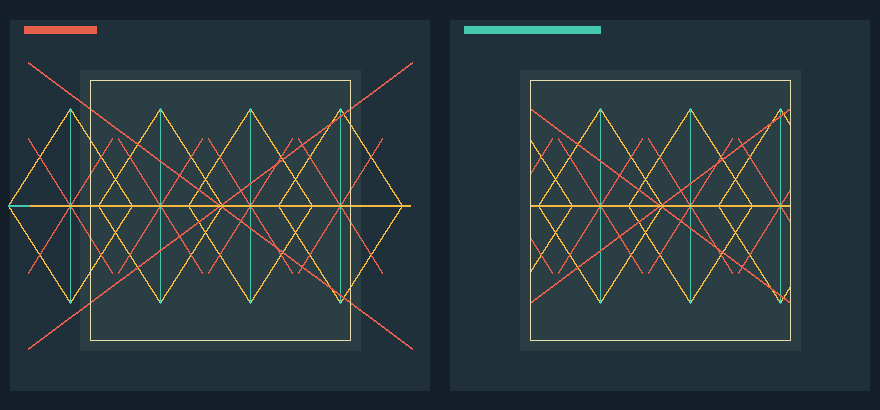

# Bresenham lines and Cohen-Sutherland clipping

Implemented by Muthii Eric Macharia, 166390, while the member originally
assigned this module was unavailable. Original assignment: Waruhiu Jeremy
Kang'ethe, 166263.

The line module draws geometric motif edges and seam-like strokes, then clips
them to a rectangular fabric window. Its public interface is in
`include/kitenge/lines.hpp`:

```cpp
void drawLine(Canvas& canvas, Point start, Point end, Color color);
std::optional<std::pair<Point2D, Point2D>>
clipLineToRect(Point2D start, Point2D end, Rect window);
```

## Bresenham rasterization

`drawLine` starts at one integer endpoint and maintains an integer error
`dx - dy`, where `dx` and `dy` are the absolute coordinate differences. On
each iteration it plots one pixel, then checks `2 * error` to decide whether
to advance x, y, or both. The signs of the coordinate differences give the
step directions. This handles horizontal, vertical, steep, shallow and
negative-slope segments without floating-point sampling. Both endpoints are
included, and a zero-length segment draws one pixel.

Endpoints are put in a consistent lexicographic order first, so reversing the
arguments draws the same pixels even when the error lands exactly on a tie.
`Canvas::setPixel` safely ignores off-canvas pixels. The integer calculations
use 64-bit values to avoid overflow when subtracting 32-bit coordinates.

## Cohen-Sutherland clipping

Each endpoint receives a four-bit outcode for the half-planes left, right,
above and below the window. A zero outcode is inside, **including the
boundary**. When both outcodes are zero, the current segment is accepted.
When they share a set bit, the whole segment is rejected. Otherwise the
outside endpoint is replaced by its intersection with one boundary, and the
test repeats. Horizontal and vertical crossing lines are handled by choosing
the boundary corresponding to a set bit; a parallel segment outside the same
half-plane is rejected before division.

Clipping returns double-precision endpoints. Callers round with `std::lround`
only when drawing pixels. A segment that touches a single corner is returned
as a zero-length segment at that corner. An endpoint on an edge is retained.
The rectangle may have a zero-width or zero-height axis; its bounds must be
ordered. Non-finite coordinates or unordered bounds throw
`std::invalid_argument`.

## Checks and limits

`tests/line_tests.cpp` covers every octant, reversed endpoints, horizontal and
vertical lines, a single point, canvas edges, visible and rejected segments,
crossings in both directions, fractional intersections, boundary segments,
corner touches and invalid inputs. `drawLine` follows the full input segment;
for very long off-canvas segments, clip to the canvas first if rendering speed
matters. This line clipper is for axis-aligned rectangles, not polygon panels.

Run `lines_demo outputs/lines-clipping.ppm` after building. The left panel
shows the full diamond-and-cross motif; the right panel shows only the parts
inside the fabric window. The cream frame is the inclusive clipping boundary.


