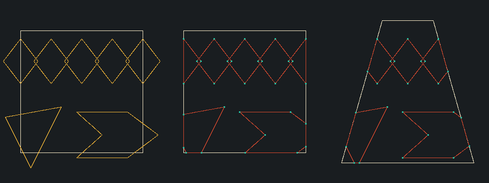

# Sutherland-Hodgman polygon clipping

Owner: Murega Kelvin Mutwiri, 166914.

Polygon clipping crops a motif so that only the part inside a fabric region is
kept. In the Kitenge project it trims geometric motifs at the edges of the
rectangular fabric swatch and at the edges of the convex bodice and skirt panels
of the simplified dress.

```cpp
// include/kitenge/polygon_clip.hpp
Polygon clipPolygonToConvex(const Polygon& subject, const Polygon& boundary);
```

## Inputs and output

- `subject`: the motif, an ordered list of `Point2D` vertices without the first
  vertex repeated at the end. It may be convex or concave.
- `boundary`: the clipping region, which must be convex. It may be listed
  clockwise or counterclockwise.
- Result: the visible part of the subject as a new `Polygon` in the subject's
  traversal order, with `double` coordinates. An empty polygon means nothing is
  visible.

## How the algorithm works

Sutherland-Hodgman clips the whole subject against one boundary edge at a time.
The output of one edge becomes the input of the next, so after the last edge
only the part inside every edge remains, which is the part inside the convex
boundary.

**Which side is inside.** For a boundary edge from `A` to `B` and a point `P`,
the cross product

```text
d(P) = (B.x - A.x) * (P.y - A.y) - (B.y - A.y) * (P.x - A.x)
```

is positive on one side of the line, negative on the other and zero on the line.
The shoelace formula gives the boundary's signed area,
`0.5 * Σ (x_i * y_(i+1) - x_(i+1) * y_i)`. Its sign is the boundary's winding, and
multiplying `d(P)` by that sign makes inside points non-negative for either
winding. Because the canvas y axis points down, a polygon that looks clockwise
on screen has a positive signed area; the code never depends on that, only on
the sign.

**One edge pass.** Each subject edge from the previous vertex `S` to the current
vertex `E` falls into one of four cases:

| `S` | `E` | Output |
| --- | --- | --- |
| inside | inside | `E` |
| inside | outside | the intersection |
| outside | inside | the intersection, then `E` |
| outside | outside | nothing |

**Intersection.** With signed distances `dS = d(S)` and `dE = d(E)` of opposite
sign, the crossing point is

```text
t = dS / (dS - dE)
I = S + t * (E - S)
```

`I` keeps its `double` value. Rounding with `std::lround` happens only when the
result is rasterized, so clipping errors don't build up across the boundary edges.

## Boundary rules and edge cases

- The boundary region is closed. A point with `d(P) >= -1e-9` counts as inside,
  so vertices lying exactly on a boundary edge are kept, and a motif whose
  corners touch the window from inside is returned unchanged.
- When a vertex lies on a clip edge, the same point can be emitted twice. Repeated
  neighbouring vertices, including a last vertex equal to the first, are removed.
- A result with fewer than three vertices or zero area has no visible interior and
  is returned as an empty polygon. This covers subjects fully outside the boundary
  and subjects that only touch it along an edge or at a corner from outside.
- A subject with fewer than three vertices, including an empty one, returns an
  empty polygon.
- A boundary with fewer than three vertices, zero area, or a reflex corner is
  rejected with `std::invalid_argument`. Collinear boundary vertices are allowed.

## Limitations

- The boundary must be convex, so a full dress outline can't be used directly.
  The dress is built from separate convex panels (bodice and skirt trapezoids),
  and a motif is clipped to each panel separately.
- A concave subject that leaves the boundary and comes back in stays one polygon.
  The pieces are joined by zero-width edges along the clip boundary. The visible
  area is correct, but an outline drawing shows those connecting edges. Filling
  the result is unaffected.
- Clipping applies to polygons only. Circles and Bézier curves aren't clipped by
  this module, so CP1 places them inside the panel interiors.
- The 1e-9 tolerance is an absolute value suited to pixel-scale coordinates.

## Verification

`tests/polygon_clip_tests.cpp` checks:

- An empty subject and a two-vertex subject return empty polygons.
- A subject fully inside the boundary, or equal to it, is returned unchanged.
- Subjects fully outside or beside the boundary return empty polygons.
- An edge crossing gives area 30 with intersections at (10, 2) and (10, 8).
- A corner crossing keeps the inside quarter.
- A fractional intersection at (10, 6.125) is kept exactly.
- Touching cases: a diamond with its vertices on the window edges is kept; a square
  sharing only an edge or a corner from outside returns an empty polygon.
- A polygon enclosing the window returns the window's area.
- A clockwise boundary gives the same result as a counterclockwise one.
- Clipping a band to a trapezoid dress panel gives area 35, with slanted-edge
  intersections at (1, 5) and (9, 5).
- A concave chevron clipped to the window keeps area 64.
- Two-vertex, zero-area and concave boundaries are rejected.

`polygon_clip_demo` writes `outputs/polygon-clipping.ppm`. Its three panels show
the original motifs over a rectangular fabric window, the motifs clipped to that
window, and the motifs clipped to a trapezoid skirt panel, with the clipped
vertices marked. Until the lines and polygon fill modules are merged, the demo
draws outlines with a preview helper that samples each edge. That helper isn't
part of the clipping algorithm and is replaced at integration.


