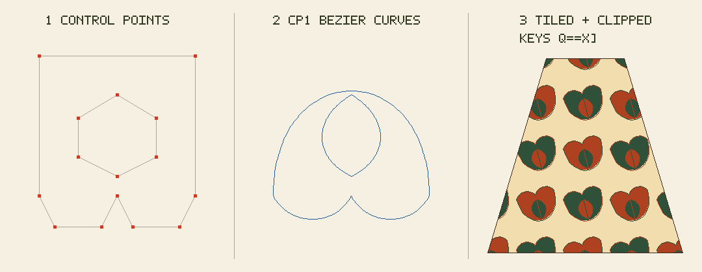
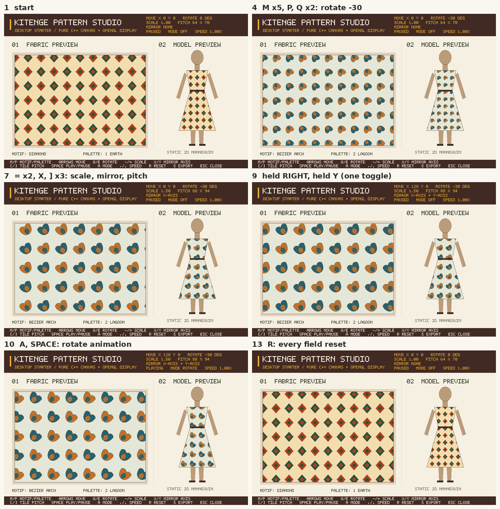
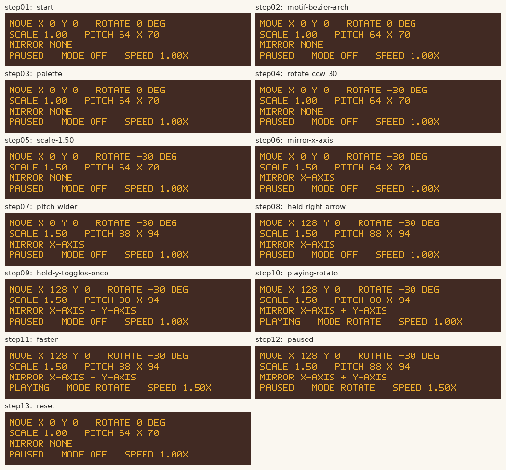

# Controls and the Bézier arch motif

**Andrew Karanja Gathirwa — 167144.** Branch `feat/cp2-controls-curves`.

This module turns key presses into studio state, and supplies one cubic
Bézier motif to the catalog. It owns `include/kitenge/controls.hpp`,
`src/controls.cpp`, `include/kitenge/desktop_keys.hpp`, `src/desktop_keys.cpp`,
`include/kitenge/curve_motif.hpp`, `src/curve_motif.cpp`,
`src/curve_motif_demo.cpp`, `tests/control_tests.cpp`,
`tests/desktop_key_tests.cpp` and `tests/real_key_session.sh`.

## How input becomes pixels

```text
GLFW key ──► ControlKey ──► ControlAction ──► reduceControl() ──► ControlState
(desktop_keys.cpp)  (key map)   (repeat filter)    (pure C++)          │
                                                                       ▼
renderStudio(canvas, state.studio, makeControlledHooks(state))
   └─ displayedPatternSettings(state, timeSeconds)
        └─ animatePatternSettings(base pattern, animation, t)      Lenina
             └─ transformMatrix → tile → clip → rasterize           Jeremy, Kelvin
drawControlStatus(canvas, state)                                    header readout
```

1. **Adapter.** `src/desktop_keys.cpp` is the only file that includes GLFW. It
   maps `GLFW_KEY_*` codes to a platform-neutral `ControlKey`.
2. **Key map.** `controlKeyBindings()` maps each `ControlKey` to one
   `ControlAction`. Every action has exactly one key.
3. **Repeat filter.** `shouldDispatch()` lets the OS auto-repeat (`GLFW_REPEAT`)
   through only for incremental adjustments. Toggles and one-shot commands fire
   once per physical press, however long the key is held.
4. **Reducer.** `reduceControl(state, action)` is a pure function. It has no
   globals, I/O or GLFW. It returns the new state, whether the action was
   accepted, and any side effect (`Export` or `Close`). The application carries
   out those effects. A step past a limit is rejected and returns the state
   unchanged.
5. **Render.** `makeControlledHooks(state)` gives Kelvin's fabric and garment
   hooks a live view of the state. The settings they draw are evaluated every
   frame by Lenina's `animatePatternSettings` from the **base** settings and
   `timeSeconds`. Base settings are never overwritten, so nothing accumulates.
   Fabric and dress read the same value, so every control updates both in the
   next frame.

### State: no duplicated fields

```cpp
struct ControlState {
    StudioState studio;          // Eric:   motif, palette, playing, timeSeconds
    PatternSettings pattern;     // Kelvin/Jeremy: base transform, tile pitch, origin
    AnimationSettings animation; // Lenina: mode and base speeds
    double animationSpeed;       // new: multiplier applied to both speeds
};
```

`ControlState` wraps the team's existing shared types and does not redefine
them. `StudioState`, `StudioAction` and `applyAction` are unchanged. M, P, Space
and R call `applyAction` inside the reducer, so the starter behaviour is
preserved by construction. A test checks that.

## Conventions

These follow the shared contract, which differs from a y-up maths textbook:

| Control | Field changed | Why |
| --- | --- | --- |
| Q, rotate counterclockwise **on screen** | `angleRadians` **decreases** | Screen y points down, so a positive angle appears clockwise (`transforms.hpp`). A test confirms the direction with Jeremy's matrix. |
| E, rotate clockwise on screen | `angleRadians` increases | |
| Up arrow | `translation.y` **decreases** | y points down |
| X, reflect across the **x-axis** | `reflectY` | Reflecting across the x-axis negates y |
| Y, reflect across the **y-axis** | `reflectX` | Reflecting across the y-axis negates x |

Angles are stored in radians, wrapped to (−180°, 180°], and shown in degrees.

## Limits and steps

One place: `struct ControlLimits` in `controls.hpp`.

| Parameter | Default | Step | Range | At the limit |
| --- | --- | --- | --- | --- |
| Translation x / y (px) | 0 | 8 | −256 … 256 | step rejected |
| Rotation | 0° | 15° | wraps | never stops |
| Uniform scale | 1.00 | 0.25 | 0.25 … 3.00 | step rejected |
| Tile pitch x / y (px) | 64 × 70 | 8 on both | 24 … 176 each | step rejected |
| Animation speed | 1.00× | 0.25× | 0.25× … 4.00× | step rejected |
| Mirror x-axis / y-axis | off | toggle | — | — |
| Motif, palette, animation mode | 0 | next | wraps at `kMotifCount`, `kPaletteCount`, `kAnimationModeCount` | wraps |

These ranges sit inside what the pattern engine accepts, including the
garment's 0.5× zoom. At the lowest values the garment receives scale 0.125 (the
minimum is 0.05) and pitch 12 px (the minimum is 4). The fastest speed gives
π rad/s rotation and a 2 Hz pulse, inside Lenina's validated bounds (4π rad/s
and 10 Hz).

A command-line start outside a range, such as `--scale 5`, can still step back
**towards** the range, so the user is never stuck. Stepping further away is
rejected.

**Speed changes never make the picture jump.** Rotation angle and pulse phase
both depend only on `speed × time`. When the multiplier changes from m to m′,
the reducer rescales `timeSeconds` by m / m′, so the frame on screen is
identical before and after the change. Pause freezes time
(`advanceStudio` owns the clock), and resume continues from the same time.
Reset restores every field and sets time to zero.

## Key map

| Key | Action | Repeats when held |
| --- | --- | --- |
| M / P | Next motif / palette | no |
| Arrow keys | Move the pattern | yes |
| Q / E | Rotate counterclockwise / clockwise on screen | yes |
| − / = (also keypad − / +) | Scale down / up | yes |
| X / Y | Mirror across the x-axis / y-axis | no |
| [ / ] | Tile pitch down / up | yes |
| Space | Play / pause | no |
| A | Animation mode: off → rotate → pulse | no |
| , / . | Animation speed down / up | yes |
| R / S / Esc | Reset / export PPM / close | no |

GLFW names keys by their US-layout position, so on other layouts the
punctuation keys are the keys in those positions.

## On-screen readout and legend

`drawControlStatus` writes four lines in the header band to the right of the
title (x ≥ 700, y < 110): translation and rotation in degrees, scale and pitch,
mirror state, and play state, mode and speed. A test renders the scene with and
without the readout and confirms that no pixel changes outside that band, so it
never covers the fabric preview or the mannequin. The bottom bar now holds a
two-line legend covering every key.

To support these labels, the studio's bitmap font gained `. , [ ] =`, and the
existing text routine is exposed as `drawStudioText` / `studioFontSupports`. A
test checks that every readout line and key label uses only supported glyphs and
fits in 40 characters.

## The Bézier arch motif

`bezierArchMotif()` is catalog motif 5, `BEZIER ARCH`.

| Part | Built from | Drawn as |
| --- | --- | --- |
| Arch body | arch top + two scalloped feet, 3 cubics, closed | fill, primary role |
| Leaf | two cubics, mirror images across x = 0 | fill, accent role |
| Outline | the arch body path | closed stroke, accent role |
| Vein | straight line between the leaf tips | stroke, primary role |

- **CP1 evaluator.** It is defined once as control points in the catalog's
  local coordinates (centred on (0, 0), y down) and sampled with the CP1
  `sampleCubicBezier`, 12 segments per curve.
- **Inside the extent.** Every control point lies inside ±25. By the convex hull
  property, every point on the curve does too. The motif passes Deborah's
  `isValidMotif` and her catalog tests, including the centring check.
- **Transformable.** Every studio transform is affine, and an affine map
  applied to control points gives exactly the curve obtained by applying it to
  each curve point. The sampled points the pattern engine transforms therefore
  lie on the transformed Bézier curve. A test checks this numerically against
  Jeremy's `transformMatrix`.
- **Clipped by the renderer.** The motif's strokes go through Kelvin's renderer
  (Cyrus–Beck plus a pixel mask). Nothing is drawn directly. A test renders it
  across a small convex window and finds no painted pixel outside the window's
  bounds.

`curve_motif_demo` shows the construction in three panels: control points
only, the same cubics drawn by the CP1 `drawCubicBezier`, and the catalog motif
tiled and clipped to a skirt panel with the settings a key script produces.



## Build and test

```sh
cmake -S . -B build-core -DKITENGE_BUILD_DESKTOP=OFF -DCMAKE_BUILD_TYPE=Debug
cmake --build build-core --parallel
ctest --test-dir build-core --output-on-failure        # includes "controls"
./build-core/curve_motif_demo outputs/curve-motif.ppm "Q==X]"
```

The demo's key script uses `M P Q E - = X Y [ ] R`, plus `< > ^ v` for the
arrows. It replays through the real key map and reducer.

The desktop build adds `desktop_keys`. It feeds real GLFW key codes and
press/repeat/release events through the adapter, without a window. Eric's
`--smoke-test` now also presses E, ] and Y (plus a `GLFW_REPEAT` of Y), and
requires the fabric and both dress panels to change in the next frame:

```sh
cmake -S . -B build-desktop -DKITENGE_BUILD_DESKTOP=ON -DKITENGE_GUI_TESTS=ON
cmake --build build-desktop --parallel
ctest --test-dir build-desktop --output-on-failure
```

`studio_render` draws the same readout from the same state as the window, so
the desktop-versus-headless pixel comparisons still match exactly.

### What `control_tests` covers

- Initial state and the default scene options
- Selection wraparound using the real catalog counts
- The starter actions agree with `applyAction`
- Upper and lower limits for translation x/y, scale, pitch x/y and speed:
  stops, rejects, leaves the state unchanged and does not request a redraw
- Recovery from an out-of-range start
- Rotation direction against Jeremy's matrix, 15° steps, a full-turn wrap and
  half-turn
- Mirroring twice restores the state, for both axes
- Reset clears every field, time included, even from launch options
- Play, pause and resume without a time jump
- A speed change keeps the frame on screen for rotate and pulse, and base
  settings are never overwritten
- Export and close effects
- No duplicate keys or actions, and the planned table
- Held-key repeat policy and a scripted callback sequence
- Readout text, width, degrees, no "−0", and drawable glyphs
- **Every visual control changes the fabric, the bodice and the skirt**
- A rotation animation updates fabric and dress, and reset restores the
  initial image pixel for pixel
- The readout stays inside the header band
- Curve endpoints, finite samples, control points inside the extent, joined
  chains, mirrored leaf, catalog registration, affine invariance, and clipped
  strokes

### Real key presses

`tests/real_key_session.sh` starts the real window (on Xvfb when `DISPLAY` is
unset). It sends genuine X11 key events with `xdotool`, including held keys
that rely on the OS auto-repeat, and saves the scene after each step with the
app's own S export. It also confirms that Esc closes the window.

```sh
tests/real_key_session.sh build-desktop/kitenge_studio outputs/real-keys
```

Recorded run (Linux, Xvfb, Mesa llvmpipe OpenGL 4.5):

- holding → for 1.2 s moved the pattern 120–128 px, i.e. 15–16 auto-repeat steps
- holding Y for 1.2 s toggled the mirror exactly once
- Q×2 gave −30°, =×2 gave 1.50, ]×3 gave pitch 88 × 94
- A and Space started the rotation, . . raised the speed, Space paused, and R
  restored every value





## Known limitations

- Clicking is not supported (not required through CP3).
- The script above runs on Linux/X11 only. On macOS and Windows, repeat the same
  steps by hand: hold an arrow key, hold X, then check the readout.
- Animation mode `Off` while playing advances time but draws the base settings,
  as Lenina's evaluator defines.
- Translation is limited to ±256 px. The pattern repeats, so a larger offset
  would only show the same tiles again.
- The legend lists the keys but has no separate help screen. The header and
  footer were enough to fit every key without covering the previews.
